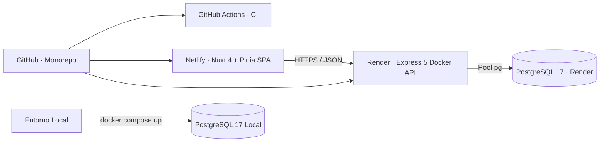

# Arquitectura del Sistema · CloudBudget

## 1. Diagrama de Arquitectura

## 2. Decisiones Técnicas
- **Monorepo con npm workspaces (`apps/web`, `apps/api`, `packages/shared`):** Sirve para compartir los esquemas de validación Zod, helpers de presupuesto y tipos TypeScript entre frontend y backend sin duplicar reglas.
- **Precisión monetaria con `NUMERIC(12,2)`:** Todos los importes de transacciones y topes de presupuesto se guardan como `NUMERIC(12,2)` en PostgreSQL para evitar errores de redondeo en punto flotante.
- **Cálculo en base de datos:** El saldo mensual (`balance`) y el monto restante de cada presupuesto (`remaining_amount`) se calculan en tiempo real con agregaciones SQL (`SUM`, `COALESCE`, `LEFT JOIN`) desde los movimientos persistidos.
- **Aislamiento por usuario:** Cada consulta y escritura filtra por `user_id`, de tal manera que cada usuario registrado solo ve y mueve sus propias categorías, movimientos y presupuestos.
